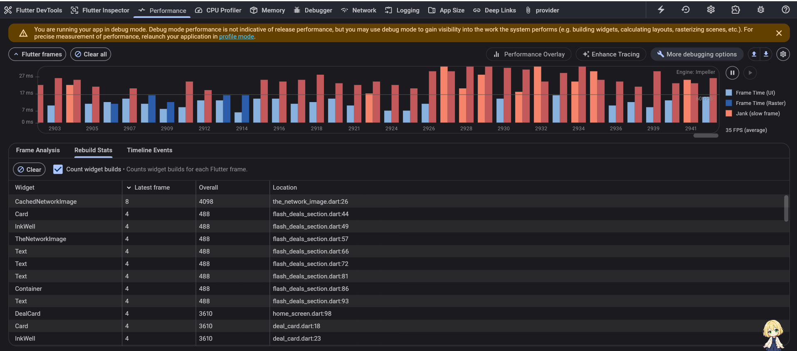
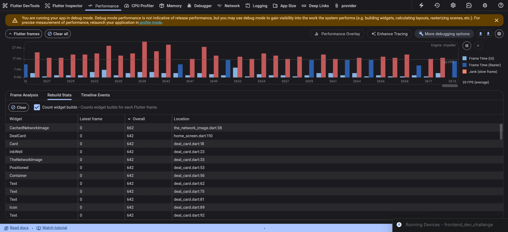

## Part A

### RES-101 (2 hours)

#### Cause

Each call to the asynchronous search function in `search_deals_controller.dart` starts a separate request. As the user types into the text box, the request that finishes last overwrites the results of requests that finished earlier. A query containing only part of the user's input, such as a single character, can take longer than the complete query. This causes results for an earlier, incomplete query to overwrite the results for the user's latest input.

#### Solution

Update `search_deals_controller.dart` to include a controller-level variable that tracks the latest query string. Compare this variable with the query string used in `_search`. If they do not match, ignore the results.

### RES-102 (1 hour 30 minutes)

#### Cause

The widget's state in `pickup_countdown.dart` creates a periodic timer that runs repeatedly until `cancel()` is called. When the user navigates back to Home from My orders, Flutter removes the page and disposes the countdown's state. However, the timer continues running and calls `setState()` on the disposed state.

#### Solution

Store the timer in a field on `_PickupCountdownState` and override `dispose()` to call `_timer.cancel()` before `super.dispose()`. This stops the timer from calling `setState()` after the state has been disposed.

### RES-103 (2 hours)

#### Cause

Each time `DealDetailsController` is initialized, it creates a listener on the shared cart's `itemCount` to call `_recheckAvailability()`. When the user returns to the home page, the controller is closed, but the listener remains active. When the user adds an item to the bag, the change in `itemCount` triggers all remaining listeners, including those that reference closed controllers.

#### Solution

Store the `Worker` returned by `ever()` and override `onClose()` in `DealDetailsController` to dispose of the worker when the user leaves the deal page. Also check `isClosed` after the awaited request in `_recheckAvailability()` to prevent an in-flight request from updating the controller after it has closed.

### RES-104 (3 hours)

#### Cause

Duplicate deal cards occur because `refreshDeals()` and `loadMore()` update the same feed and page counter without coordinating their in-flight requests. In the original implementation, `loadMore()` increments `_page` before awaiting the next page. If refresh finishes first, it replaces the feed with page 1 and resets `_page` to 1. The older pagination request then appends its results without advancing the reset counter. The next pagination request fetches page 2 again, creating duplicate cards.

Reproduction test case:

1. Load page 1 of the home feed.
2. Scroll to the bottom to request page 2, keeping that request pending.
3. Pull down to refresh and let the new page 1 request finish first.
4. Let the older page 2 request finish.
5. Scroll to the bottom again.

Before the fix, page 2 is appended twice. Continuing through the catalog can produce 142 cards for 122 unique deals. After the fix, the stale response is ignored, the next load requests page 2, and each deal appears once.

Additional test cases:

| Case | Expected result |
|---|---|
| Pagination finishes before refresh | The successful refresh replaces the old feed, and the next load requests page 2. |
| An old page 3 request fails after refresh succeeds | The refreshed page counter stays at 1, and the footer does not show a failure for the stale request. |
| The current pagination request fails | The footer shows a failure, and retry requests the same page, including when the last page fails. |
| Refresh fails while pagination is pending | Existing deals remain available, and valid pagination results can still be retained without duplicates or skipped pages. |
| Refresh succeeds after the catalog is exhausted | The exhausted footer resets, and pagination can load page 2 again. |

Request order can be controlled with repository test doubles and `Completer` objects. Failure cases require injected errors because the current fake feed endpoint does not throw.

#### Solution

Use `_isRefresh` to prevent overlapping refreshes and block new pagination requests while refresh is running. After a successful refresh, reset `_page` to 1 and `_nextPage` to 2. Compare the pagination state before accepting a response or handling an error so that stale requests cannot update the refreshed feed. Roll back the page counter only when the current pagination request fails, allowing the same page to be retried. Clear loading flags in `finally`, report current failures through the refresh controller, and reset the exhausted footer after a successful refresh.

### RES-105 (2 hours)

#### Cause

Three issues contributed to scrolling work and image memory pressure:

1. Every scroll-offset change updated an observable read by the `Obx` wrapping the whole home screen. This repeatedly rebuilt the Scaffold and feed, although the offset was only needed for the app-bar shadow and scroll-to-top button.
2. The feed used `ListView(children: ...)` and mapped every loaded deal into a `DealCard`. Each feed rebuild copied or filtered the deal list and recreated all those card widgets. Loading another page increased this work. Flutter still mounted list children lazily; creating all the widget configurations did not mean every offscreen card subtree or image was loaded immediately.
3. The API supplied 1600 by 1200 images, but `TheNetworkImage` only specified display dimensions. Without a decode-size hint, small cards could retain full-resolution decoded images. One 1600 by 1200 RGBA image requires approximately 7.3 MiB of pixel data, excluding other overhead.

#### Solution

Keep the feed's data observer inside the Scaffold body and give the scroll-to-top button its own `Obx`. Replace the observable pixel offset with `showScrollToTop`. The scroll listener updates that boolean only when the offset crosses the 800-logical-pixel threshold. The button appears above 800 and hides at or below 800, including during its scroll-to-top animation. Scrolling within either range causes no reactive update. Flutter's built-in `scrolledUnderElevation` handles the app-bar shadow without rebuilding the feed; this replaces the previous custom 4-pixel shadow threshold.

Replace the feed's explicit children list with a `CustomScrollView`. Use `SliverToBoxAdapter` for the flash rail, header/filter, and bottom spacing, and a `SliverList` with `SliverChildBuilderDelegate` for the deal cards. Cards are created near the viewport as needed and keyed by deal ID. Read `visibleDeals` and copy `flashDeals` inside the body observer before constructing the lazy delegate, so reactive dependencies are registered there and the delegate uses a stable data snapshot. Keep the existing refresh callbacks, pagination callbacks, and scroll controller connected to the same scroll view.

Wrap the shared network image in `LayoutBuilder`. Determine its finite display width from the explicit width or available constraints, multiply by `MediaQuery.devicePixelRatioOf(context)`, and pass the rounded-up physical width as `memCacheWidth` to `CachedNetworkImage`. Setting only the decode width preserves the source aspect ratio. Explicit finite widths are constrained to the available layout width; an unbounded or non-positive width falls back to the original decode behavior.

#### Alternatives considered

- Removing the scroll listener and always showing the button avoids custom scroll tracking, but changes its intended visibility. A threshold boolean preserves the 800-pixel behavior without publishing every pixel change.

#### limitations

- The sliver list uses the filtered snapshot's length, including when the filter produces no deals. Flash-rail presence and feed data changes are observed separately from button visibility.
- Decode sizing currently considers width only. Tall or square `BoxFit.cover` destinations may need a larger decode to maintain sharpness after cropping. A general height-aware solution needs the source aspect ratio; that improvement is not implemented.
- Different display widths can create separate decoded cache entries for the same URL. Actual cache residency and image sharpness across layouts still need measurement.
- Smaller decoding does not guarantee faster network loading.

#### Validation and performance evidence

The before/after screenshots in `img_solution/` capture the Flutter DevTools Performance screen with **Count widget builds** enabled. The following values are transcribed from those captures:

| DevTools metric | Before | After |
|---|---|---|
| `DealCard` builds, latest displayed frame | 4 | 0 |
| `DealCard` builds, overall recorded count | 3,610 | 642 |
| `CachedNetworkImage` builds, latest displayed frame | 8 | 0 |
| `CachedNetworkImage` builds, overall recorded count | 4,098 | 662 |
| Displayed average FPS | 35 | 35 |

Before:

After:

### RES-106 (30 min)

#### Cause

The API returns valid ISO-8601 UTC instants. `DateTime.parse()` preserves UTC, but `PickupWindowModel.label` formatted those UTC hours directly. For example, a November 20 pickup window of 06:00–09:30 in Bangkok is returned as November 19 at 23:00 UTC through November 20 at 02:30 UTC. Formatting those values without converting them caused the card to show 23:00–02:30.

`isToday` also compared only `start.day` with `DateTime.now().day`. This mixed the pickup's UTC calendar date with the device's local calendar date, excluding early-morning pickups that started on the previous UTC day. Ignoring month and year could also classify an unrelated date as today. Finally, time passing alone did not rebuild the home feed, so the filter could remain stale after midnight.

#### Solution

Convert both pickup timestamps with `.toLocal()` in `PickupWindowModel.fromJson()`. This preserves their original instants while making labels and calendar-date comparisons use the machine's timezone. On a device using Bangkok time, the bakery now displays 06:00–09:30. Compare year, month, and day against one captured `DateTime.now()` in `isToday`.

Schedule a one-shot timer for the next local midnight in `HomeController`. When the date changes, reuse the existing page-loading flow to refresh the home feed and flash deals. The existing filter is reapplied, and its selected state is preserved. Reschedule for each following midnight. Constructing the next calendar midnight avoids assuming every local day lasts exactly 24 hours.

Observe app lifecycle changes and refresh on resume if the local date changed while the app was suspended. Cancel the timer and remove the observer when the controller closes. Ignore asynchronous results after the controller has closed.

#### Alternatives considered

- A separate reactive date used by the filter could update the list without fetching data. Reusing the existing page refresh was chosen to keep filtering in `isToday` and reload the home page through its existing flow.

### RES-107 (approximately 1 hour)

#### Cause

The details controller cast `Get.arguments` directly to `DealModel`. Home and flash cards supplied that object, but deep links supply only URL parameters. For `/deal?id=42&source=push`, `Get.parameters` contains the ID and source while `Get.arguments` is null. The cast therefore failed during controller initialization, before any deal request could run. The screen also read a synchronous `late final deal`, so adding an asynchronous request alone would leave a second initialization problem.

#### Solution

Capture `id` and `source` from `Get.parameters` in `onInit()`. Validate the ID and load the full model through `DealRepo.fetchById()`. The ID selects the deal; source is attribution metadata for `deal_details_view`, defaulting to `unknown`. Capture both before awaiting so navigating elsewhere cannot change a pending request's attribution or a retry's ID.

Expose a nullable observable deal with loading and error state. Show the loading indicator until the request finishes, then render the existing details content and Add to bag action. Failed requests show a readable error and allow retrying the same ID. Remove `arguments: deal` from shared cards and the flash rail so all entry points use the same parameter-based contract.

Create the cart availability worker only after successful loading and dispose it safely when the controller closes. Ignore results after closure, including when the user leaves during the initial request. Availability refresh failures are logged rather than becoming unhandled asynchronous errors.

#### Alternatives considered and edge cases

- Keeping the argument as a fast path would avoid a request after a card tap, but would retain two data-loading paths and could display stale card data. The requested implementation always loads by route ID.
- Making the cast nullable or redirecting every deep link to an error screen would avoid the original exception without loading an existing deal. Neither fulfills this ticket.
- Missing, malformed, zero, and negative IDs do not trigger API requests. A 404 shows an unavailable message; other failures offer retry. No view event is emitted for failed or abandoned loads.
- Platform cold/warm-launch delivery and stacking multiple instances of the deal route were not exercised by these tests. Native link configuration was left unchanged.

#### Validation and AI usage

`flutter test --no-pub test/deal_details_test.dart` passed all 11 tests on the pinned Flutter 3.27.0 SDK. Coverage includes query-only navigation to deal 42, loading state, loaded content and Add to bag, parameter capture, invalid IDs, 404, failed-request retry, leaving during loading, and cart worker cleanup. Flutter analysis of the changed Dart files and test found no issues. Android device reproduction was not performed.

Codex traced the route/controller flow, implemented the change, and wrote and ran the regression tests. Its first test cleanup incorrectly used `await Get.reset()`; compilation showed this version returns `void`, so cleanup was corrected to call it synchronously before the successful test run.
