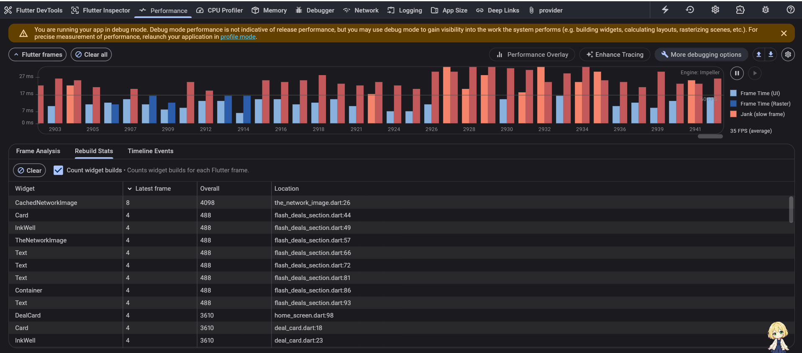
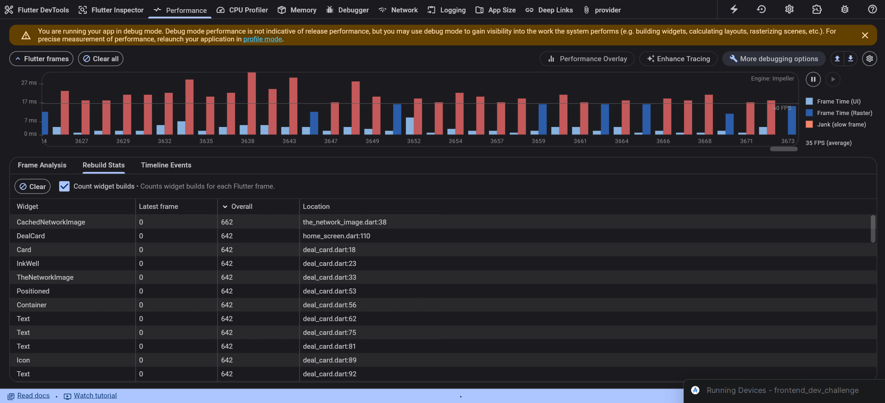

## Part A

### RES-101 (2 hours)

#### Cause

Each call to the asynchronous search function in `search_deals_controller.dart` starts a separate request. As the user types into the text box, the request that finishes last overwrites the results of requests that finished earlier. A query containing only part of the user's input, such as a single character, can take longer than the complete query. This causes results for an earlier, incomplete query to overwrite the results for the user's latest input.

#### Solution

Update `search_deals_controller.dart` to include a controller-level variable that tracks the latest query string. Compare this variable with the query string used in `_search`. If they do not match, ignore the results.

### RES-102 (1 hour 30 minutes)

#### Cause

The widget's state in `pickup_countdown.dart` creates a periodic timer that runs repeatedly until `cancel()` is called. When the user navigates back to Home from My orders, Flutter removes the page and disposes the countdown's state. However, the timer continues running and calls `setState()` on the disposed state.

#### Solution

Store the timer in a field on `_PickupCountdownState` and override `dispose()` to call `_timer.cancel()` before `super.dispose()`. This stops the timer from calling `setState()` after the state has been disposed.

### RES-103 (2 hours)

#### Cause

Each time `DealDetailsController` is initialized, it creates a listener on the shared cart's `itemCount` to call `_recheckAvailability()`. When the user returns to the home page, the controller is closed, but the listener remains active. When the user adds an item to the bag, the change in `itemCount` triggers all remaining listeners, including those that reference closed controllers.

#### Solution

Store the `Worker` returned by `ever()` and override `onClose()` in `DealDetailsController` to dispose of the worker when the user leaves the deal page. Also check `isClosed` after the awaited request in `_recheckAvailability()` to prevent an in-flight request from updating the controller after it has closed.

### RES-104 (3 hours)

#### Cause

Duplicate deal cards occur because `refreshDeals()` and `loadMore()` update the same feed and page counter without coordinating their in-flight requests. In the original implementation, `loadMore()` increments `_page` before awaiting the next page. If refresh finishes first, it replaces the feed with page 1 and resets `_page` to 1. The older pagination request then appends its results without advancing the reset counter. The next pagination request fetches page 2 again, creating duplicate cards.

Reproduction test case:

1. Load page 1 of the home feed.
2. Scroll to the bottom to request page 2, keeping that request pending.
3. Pull down to refresh and let the new page 1 request finish first.
4. Let the older page 2 request finish.
5. Scroll to the bottom again.

Before the fix, page 2 is appended twice. Continuing through the catalog can produce 142 cards for 122 unique deals. After the fix, the stale response is ignored, the next load requests page 2, and each deal appears once.

Additional test cases:

| Case | Expected result |
|---|---|
| Pagination finishes before refresh | The successful refresh replaces the old feed, and the next load requests page 2. |
| An old page 3 request fails after refresh succeeds | The refreshed page counter stays at 1, and the footer does not show a failure for the stale request. |
| The current pagination request fails | The footer shows a failure, and retry requests the same page, including when the last page fails. |
| Refresh fails while pagination is pending | Existing deals remain available, and valid pagination results can still be retained without duplicates or skipped pages. |
| Refresh succeeds after the catalog is exhausted | The exhausted footer resets, and pagination can load page 2 again. |

Request order can be controlled with repository test doubles and `Completer` objects. Failure cases require injected errors because the current fake feed endpoint does not throw.

#### Solution

Use `_isRefresh` to prevent overlapping refreshes and block new pagination requests while refresh is running. After a successful refresh, reset `_page` to 1 and `_nextPage` to 2. Compare the pagination state before accepting a response or handling an error so that stale requests cannot update the refreshed feed. Roll back the page counter only when the current pagination request fails, allowing the same page to be retried. Clear loading flags in `finally`, report current failures through the refresh controller, and reset the exhausted footer after a successful refresh.

### RES-105 (2 hours)

#### Cause

Three issues contributed to scrolling work and image memory pressure:

1. Every scroll-offset change updated an observable read by the `Obx` wrapping the whole home screen. This repeatedly rebuilt the Scaffold and feed, although the offset was only needed for the app-bar shadow and scroll-to-top button.
2. The feed used `ListView(children: ...)` and mapped every loaded deal into a `DealCard`. Each feed rebuild copied or filtered the deal list and recreated all those card widgets. Loading another page increased this work. Flutter still mounted list children lazily; creating all the widget configurations did not mean every offscreen card subtree or image was loaded immediately.
3. The API supplied 1600 by 1200 images, but `TheNetworkImage` only specified display dimensions. Without a decode-size hint, small cards could retain full-resolution decoded images. One 1600 by 1200 RGBA image requires approximately 7.3 MiB of pixel data, excluding other overhead.

#### Solution

Keep the feed's data observer inside the Scaffold body and give the scroll-to-top button its own `Obx`. Replace the observable pixel offset with `showScrollToTop`. The scroll listener updates that boolean only when the offset crosses the 800-logical-pixel threshold. The button appears above 800 and hides at or below 800, including during its scroll-to-top animation. Scrolling within either range causes no reactive update. Flutter's built-in `scrolledUnderElevation` handles the app-bar shadow without rebuilding the feed; this replaces the previous custom 4-pixel shadow threshold.

Replace the feed's explicit children list with a `CustomScrollView`. Use `SliverToBoxAdapter` for the flash rail, header/filter, and bottom spacing, and a `SliverList` with `SliverChildBuilderDelegate` for the deal cards. Cards are created near the viewport as needed and keyed by deal ID. Read `visibleDeals` and copy `flashDeals` inside the body observer before constructing the lazy delegate, so reactive dependencies are registered there and the delegate uses a stable data snapshot. Keep the existing refresh callbacks, pagination callbacks, and scroll controller connected to the same scroll view.

Wrap the shared network image in `LayoutBuilder`. Determine its finite display width from the explicit width or available constraints, multiply by `MediaQuery.devicePixelRatioOf(context)`, and pass the rounded-up physical width as `memCacheWidth` to `CachedNetworkImage`. Setting only the decode width preserves the source aspect ratio. Explicit finite widths are constrained to the available layout width; an unbounded or non-positive width falls back to the original decode behavior.

#### Alternatives considered

- Removing the scroll listener and always showing the button avoids custom scroll tracking, but changes its intended visibility. A threshold boolean preserves the 800-pixel behavior without publishing every pixel change.

#### limitations

- The sliver list uses the filtered snapshot's length, including when the filter produces no deals. Flash-rail presence and feed data changes are observed separately from button visibility.
- Decode sizing currently considers width only. Tall or square `BoxFit.cover` destinations may need a larger decode to maintain sharpness after cropping. A general height-aware solution needs the source aspect ratio; that improvement is not implemented.
- Different display widths can create separate decoded cache entries for the same URL. Actual cache residency and image sharpness across layouts still need measurement.
- Smaller decoding does not guarantee faster network loading.

#### Validation and performance evidence

The before/after screenshots in `img_solution/` capture the Flutter DevTools Performance screen with **Count widget builds** enabled. The following values are transcribed from those captures:

| DevTools metric | Before | After |
|---|---|---|
| `DealCard` builds, latest displayed frame | 4 | 0 |
| `DealCard` builds, overall recorded count | 3,610 | 642 |
| `CachedNetworkImage` builds, latest displayed frame | 8 | 0 |
| `CachedNetworkImage` builds, overall recorded count | 4,098 | 662 |
| Displayed average FPS | 35 | 35 |

Before:

After:

### RES-106 (30 min)

#### Cause

The API returns valid ISO-8601 UTC instants. `DateTime.parse()` preserves UTC, but `PickupWindowModel.label` formatted those UTC hours directly. For example, a November 20 pickup window of 06:00–09:30 in Bangkok is returned as November 19 at 23:00 UTC through November 20 at 02:30 UTC. Formatting those values without converting them caused the card to show 23:00–02:30.

`isToday` also compared only `start.day` with `DateTime.now().day`. This mixed the pickup's UTC calendar date with the device's local calendar date, excluding early-morning pickups that started on the previous UTC day. Ignoring month and year could also classify an unrelated date as today. Finally, time passing alone did not rebuild the home feed, so the filter could remain stale after midnight.

#### Solution

Convert both pickup timestamps with `.toLocal()` in `PickupWindowModel.fromJson()`. This preserves their original instants while making labels and calendar-date comparisons use the machine's timezone. On a device using Bangkok time, the bakery now displays 06:00–09:30. Compare year, month, and day against one captured `DateTime.now()` in `isToday`.

Schedule a one-shot timer for the next local midnight in `HomeController`. When the date changes, reuse the existing page-loading flow to refresh the home feed and flash deals. The existing filter is reapplied, and its selected state is preserved. Reschedule for each following midnight. Constructing the next calendar midnight avoids assuming every local day lasts exactly 24 hours.

Observe app lifecycle changes and refresh on resume if the local date changed while the app was suspended. Cancel the timer and remove the observer when the controller closes. Ignore asynchronous results after the controller has closed.

#### Alternatives considered

- A separate reactive date used by the filter could update the list without fetching data. Reusing the existing page refresh was chosen to keep filtering in `isToday` and reload the home page through its existing flow.

### RES-107 (approximately 1 hour)

#### Cause

The details controller cast `Get.arguments` directly to `DealModel`. Home and flash cards supplied that object, but deep links supply only URL parameters. For `/deal?id=42&source=push`, `Get.parameters` contains the ID and source while `Get.arguments` is null. The cast therefore failed during controller initialization, before any deal request could run. The screen also read a synchronous `late final deal`, so adding an asynchronous request alone would leave a second initialization problem.

#### Solution

Capture `id` and `source` from `Get.parameters` in `onInit()`. Use a `DealModel` supplied through `Get.arguments` immediately, as home/search cards and the flash rail already have the full object. When no model argument is available, validate the URL ID and load the full model through `DealRepo.fetchById()`. Source is attribution metadata for `deal_details_view`, defaulting to `unknown`. Capture the parameters before awaiting so navigating elsewhere cannot change a pending request's attribution or a retry's ID.

Expose a nullable observable deal with loading and error state. Card navigation passes `arguments: deal` and displays the details immediately without an initial request. Deep links show a loading indicator until the request finishes, then render the existing details content and Add to bag action. Failed requests show a readable error and allow retrying the same ID.

Initialize quantity, view analytics, and the cart availability worker through one shared method for both the argument and fetched-model paths. Dispose the worker safely when the controller closes. Ignore results after closure, including when the user leaves during the initial request. Availability refresh failures are logged rather than becoming unhandled asynchronous errors.

#### Alternatives considered and edge cases

- Always fetching by URL ID would give both entry points fresh data, but adds a request and a loading delay after every card tap. Using the passed model preserves the previous card behavior; the existing cart availability checks still refresh stock when the cart changes. Other model fields retain the card's snapshot until the page is reopened.
- Making the cast nullable or redirecting every deep link to an error screen would avoid the original exception without loading an existing deal. Neither fulfills this ticket.
- Without a model argument, missing, malformed, zero, and negative IDs do not trigger API requests. A 404 shows an unavailable message; other failures offer retry. No view event is emitted for failed or abandoned loads. A supplied `DealModel` takes precedence over URL ID validation; non-model arguments use the URL fallback.
- Platform cold/warm-launch delivery and stacking multiple instances of the deal route were not exercised by these tests. Native link configuration was left unchanged.

#### Validation and AI usage

`flutter test --no-pub test/deal_details_test.dart` passed all 15 tests on the pinned Flutter 3.27.0 SDK. Coverage includes query-only navigation to deal 42, real shared-card and flash-rail navigation using model arguments without an initial fetch, model precedence over an invalid URL ID, non-model argument fallback, loading state, loaded content and Add to bag, source attribution, parameter capture, invalid IDs, 404, failed-request retry, leaving during loading, and cart worker cleanup. Flutter analysis of the changed Dart files and test found no issues. Android device reproduction was not performed.

Codex traced the route/controller flow, implemented the change, and wrote and ran the regression tests. Its first test cleanup incorrectly used `await Get.reset()`; compilation showed this version returns `void`, so cleanup was corrected to call it synchronously before the successful test run.

## Part B

### F-1 — Live flash-sale countdowns

#### Implementation and decisions

`FlashSaleService` owns one shared one-shot timer, scheduled for the next second
boundary or the nearest exact expiry, whichever comes first. Mounted countdowns
and the bag register callbacks and unsubscribe when disposed. The timer stops
when no future deadlines are watched and pauses while the app is inactive. On
resume, every subscriber reconciles against the current instant. The clock is
injectable so tests can advance time deterministically.

Remaining time is calculated from `flashSaleEndsAt`, never by decrementing a
counter. UTC and local timestamps representing the same instant give the same
answer. Positive fractional seconds round up; an active sale never displays
`00:00`. At an hour the format becomes `hh:mm:ss`; below an hour it is `mm:ss`.
At or past the deadline the label is `Expired`.

`FlashSaleCountdown` rebuilds only its Text. It is used by the flash rail, shared
home/search cards, and the details page. `FlashSaleState` changes only when the
expired boolean changes. Cards retain their expensive child subtree, dim at
expiry, and block pointer and keyboard interaction. The details Add to bag
button becomes disabled and displays `Expired`.

Details opened from a card use its `DealModel` argument immediately, preserving
the original flash-sale deadline without another initial request. ID-only deep
links fetch the model. Both paths share quantity, analytics, and availability
worker initialization. Cart changes still recheck stock; countdown ticks do
not fetch data. F-1 tests navigate through the real route for both entry paths
and verify live expiry, bag removal, rejection of already-expired deals, and
worker cleanup after leaving the page.

Model-first refactor validation: the full `flutter test --no-pub` suite passes
all 51 tests, including both F-1 entry paths and RES-101–107 regressions.

Bag expiry belongs to the app-wide `CartService`, not a card or details
controller. It keeps its own subscription to the nearest bag deadline, removes
all expired lines in one update, recalculates count/total, and shows one bottom
notice naming the removed deal or reporting the number removed. This works
when no deal card is mounted. Removing or clearing a line updates the watch.
`add()` also checks the timestamp synchronously, returns an explicit result,
and rejects expired deals. The details controller shows success only after a
successful add; stock-limit failures no longer produce a false success notice.

Checkout rechecks expiry immediately before submission. If that removes any
lines, submission stops so the user can review the changed bag and total.
Once a request has been submitted, its backend result remains authoritative:
expiry still removes the local line, but a successful submitted order is
confirmed. The fake checkout endpoint does not enforce flash-sale deadlines,
and the client cannot cancel or undo an accepted backend order. Both cases are
covered by controlled-request tests.

#### AI usage

Codex implemented the clock, widgets, bag guards, integration, regression tests,
and this write-up. Its first lifecycle test incorrectly awaited
`handleAppLifecycleStateChanged`, which returns void in this SDK; compilation
caught that and the awaits were removed. Its first rebuild counter filtered on
`builtOnce`, but in this Flutter version that flag is only set when verbose
rebuild logging is enabled. Reading the framework implementation showed the
mistake; the test now installs the callback after initial layout and counts all
subsequent builds. A test also assumed a shorter GetX snackbar close animation;
the pinned package defaults to one second, so teardown now finishes that
animation before disposing the overlay.

### F-2 — Impression tracking

`DealImpressionTracker` measures the content bounds of each home, search, and
flash-rail card, excluding the surrounding card margins. A card starts one
one-shot timer only after its image's first successfully decoded frame has
rendered and at least 50% of its area is visible. Changes that stay
above 50% preserve the timer; falling below cancels it. The interval must be
continuous, so separate short visits never accumulate. A deal/source change,
route coverage (including popup routes), app inactivity, or widget removal
also cancels qualification. Resume/uncover rechecks visibility and starts a
fresh interval. The horizontal rail is clipped by both its own viewport and
the outer vertical viewport.

`AnalyticsService` synchronously claims the deal ID in an app-session set before
recording `deal_impression`. This makes deduplication global across simultaneous
placements, screen navigation, filtering, refreshes, and widget remounts. The
first qualifying placement wins attribution. Sources are `home_feed`,
`flash_rail`, and `search`; positions are zero-based indexes in the displayed
list (after filtering). Position changes alone preserve dwell and the event
captures the index when it qualifies. A fresh app session gets a new set.

All events logged through the service, including existing screen/detail views,
enter the same delivery queue. Ten queued events trigger a request immediately;
otherwise the oldest unsent event sets a 15-second deadline. Later arrivals
do not move that deadline. Requests contain at most ten events and never overlap.
New arrivals stay behind the in-flight snapshot; success removes only that
snapshot and checks whether the remaining queue is already due. Debug history
remains visible after successful delivery. Failure retains the original events
and retries after 1, 2, 4, 8, 16, then at most 30 seconds, without relogging or
releasing session deduplication. Resume reconciles overdue queue deadlines.
The supplied fake endpoint and seed assets were not changed.

#### Performance and alternatives

Visibility callbacks only update plain fields and start/cancel qualification
timers. They do not update feed observables or call `setState` while scrolling.
When tracking finishes, only the small tracker boundary rebuilds once to
disable its detector callback; its expensive card child is retained. There is
no per-frame Dart polling loop and no periodic timer per card. Existing lazy
lists, scoped flash countdowns, and image decoding behavior are preserved.

The package's default 500 ms callback batching can miss a short dip below 50%,
so production uses frame-end visibility notifications. This trades additional
geometry work during scrolling for accurate threshold interruptions. A manual
scroll listener with per-card global-coordinate queries was rejected because
it duplicates clipping logic, especially for nested scrolling. Per-screen
deduplication was rejected because the same deal appears on multiple screens.
A periodic 15-second flush was rejected because its schedule would not be tied
to the first unsent event.

Visibility is defined by viewport clipping. The package does not detect arbitrary
sibling occlusion or opacity; explicit route/app lifecycle guards cover common
screen/dialog/background cases. Delivery is in memory and best effort across
process termination. No persistence or server-side idempotency contract was
added; a real transport failure after server acceptance could require server
deduplication to guarantee exactly-once delivery.

F-2 startup correction: `AnalyticsService` accepts an optional nullable API
parameter. An untyped `Get.find()` in its production registration therefore
inferred `FakeApiService?`, which GetX treats as a different registration key
from `FakeApiService`. Initialization threw before `runApp`, leaving the native
splash visible. The lookup now explicitly requests `Get.find<FakeApiService>()`.
The earlier feature tests supplied their own dependencies and missed this
production wiring error. A new bootstrap test exercises the real initializer,
including bundled asset loading and lazy repository resolution; it reproduced
the exact startup exception before the fix.

Image-ready refinement requested after F-2: placeholders and failed images do
not qualify, regardless of how long the card is visible. `TheNetworkImage`
notifies the nearest tracker after its decoded image frame renders. This signal
starts a fresh one-second interval without rebuilding the card/feed. The same
rule applies to memory-cached images. If the URL changes before qualification,
readiness and dwell reset; stale completion for the old URL is ignored. Successful
loading while offscreen does not start dwell until visibility reaches 50%.
The custom image builder retains the resized image provider/cache key, preserving
the RES-105 display-sized decoding fix. Ten new deterministic image-stream tests
cover success, delay, failure, cached loading, clipping, URL replacement, all
three card placements, decode width, and rebuild isolation. No backend or package
changes were needed; no device profiling was performed for this refinement.

## F-3 — Stock reservations with optimistic UI

### Implementation and alternatives

The bag previously changed local quantities without calling the reservation
endpoints. Checkout already accepted a reservation ID, but the bag never supplied
one. `CartService` now owns reservations for the full app session, with an
injected `OrderRepo` and the existing shared clock.

Each added unit immediately appears in the bag, count, and total, then requests
its own one-unit hold. Pending units show “Reserving…” and prevent checkout.
Confirmation replaces the pending unit while keeping its unique operation token.
A failed reservation removes only that unit and shows a plain-language notice.
Removing a pending unit cancels the local intent: a late successful response is
released, and a late failure does not affect a replacement addition. Bag lines
and their unit lists are immutable, including the checkout snapshot.

There is no reservation adjustment endpoint. I chose one hold per unit, grouped
into one visible bag line. Replacing a full-line hold on every quantity change
would either release valid stock before securing a replacement or temporarily
reserve overlapping quantities. Per-unit holds avoid that gap and preserve the
original expiry of existing units. The tradeoff is more reservation requests.
The checkout endpoint accepts repeated deal IDs; the repository submits one
entry per unit and validates nonempty, unique reservation IDs, deal identity,
and quantity before sending anything.

Decrement cancels a pending addition first, otherwise releasing the earliest
confirmed hold and retaining longer-lived holds. Remove and clear release all
confirmed units. Flash-sale expiry releases holds too. Failed release calls
receive at most three attempts, with one- and two-second retry delays, using
the shared clock rather than separate countdown timers. Retry work stops once
the hold has expired or the service closes. Shutdown and late responses receive
best-effort cleanup; the server deadline is the fallback if cleanup cannot reach
the server.

### Checkout and expiry during payment

The cart service acquires an app-wide lock and captures immutable submitted
items before starting checkout. Every mutation path checks the lock; opening
another cart controller cannot start a second request. Only fully confirmed
units can be submitted.

While checkout is pending, local expiry can remove displayed units, but submitted
reservation IDs are not released until the response arrives. If the bag becomes
empty during this time, it shows “Confirming your order…” rather than an ordinary
empty state. The server result remains authoritative: a successful order is
confirmed even if the client countdown crossed zero while awaiting the response.
Success removes submitted units and cleans up remaining holds; the simulator
does not consume reservation records automatically.

A `410` says that an ID is expired or unknown but does not identify which ID.
The conservative response is to invalidate all submitted holds, release them,
and ask the user to add the deals again. This sacrifices some potentially valid
holds to avoid repeatedly submitting an unknown invalid ID. It neither retries
payment nor silently reserves a changed order. Other checkout failures preserve
valid holds and reconcile expired ones. The known gateway-timeout response
explains that the card was not charged; unexpected failures advise checking
My orders before retrying. The app-wide lock is always reset in `finally`, even
if the originating controller was closed.

### Validation and limits

`test/stock_reservation_test.dart` drives the real repository with controlled
API responses and an injectable clock. It covers immediate feedback, out-of-order
responses, partial rollback, cancellation and re-addition, quantity limits,
release cleanup and bounded retries, exact expiry, resume, flash-sale interaction,
malformed/expired responses, immutable snapshots, checkout IDs and quantities,
mid-checkout expiry, `410`, other failures, route changes, button availability,
and countdown rebuild scope. Existing flash-sale and details tests now explicitly
inject immediate reservation fixtures; their original behavior assertions remain.
The startup test also verifies that the cart uses the registered order repository.